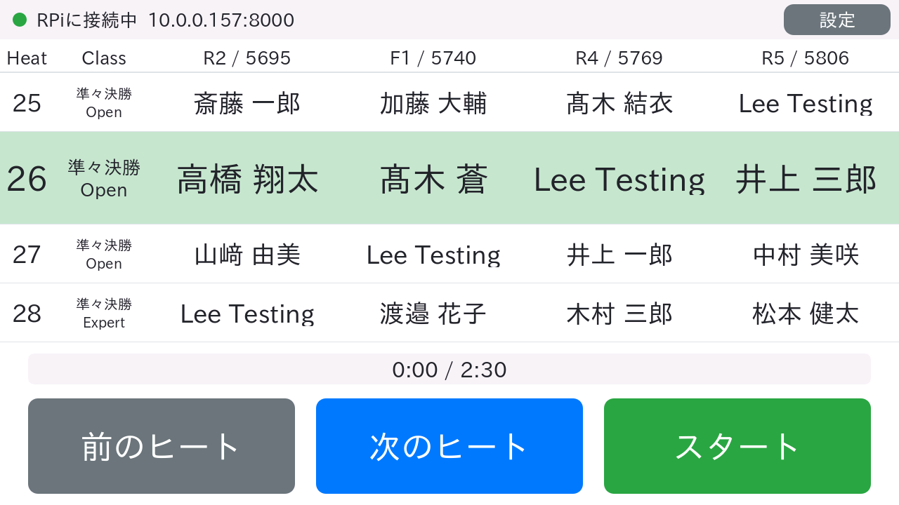
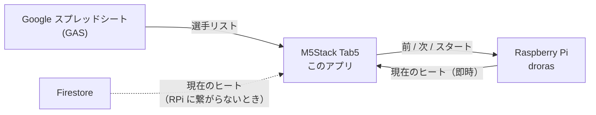
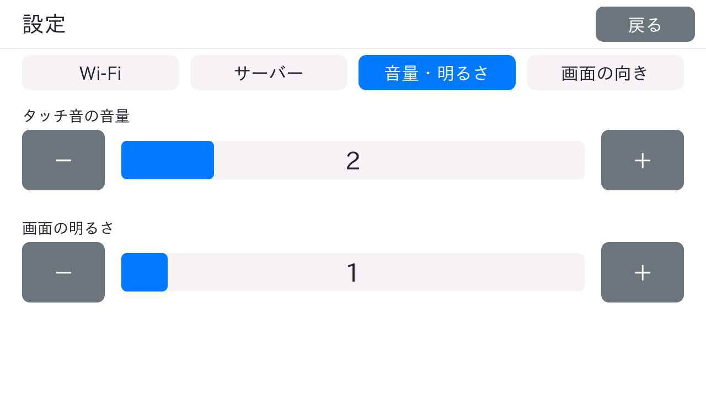
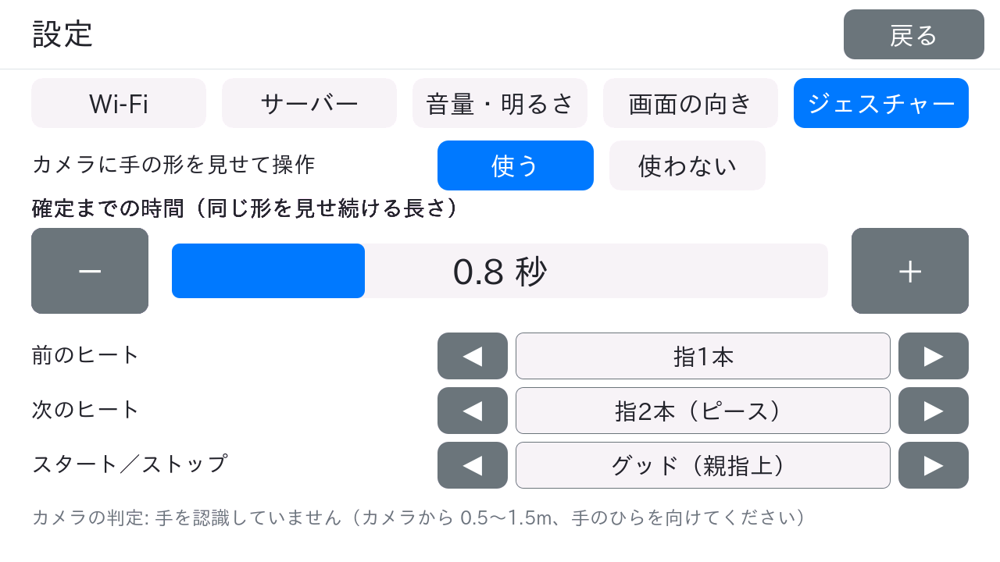
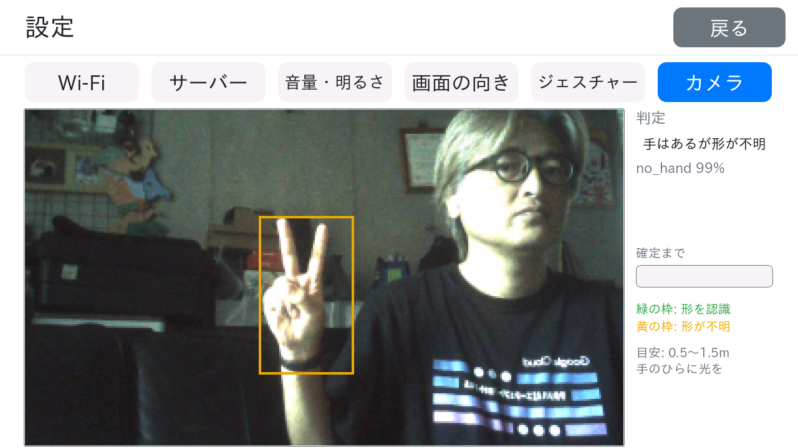

# droras-tab5

ドローンレースの **「いま誰が飛ぶのか」を表示する、手のひらサイズのヒート表**です。
[M5Stack Tab5](https://docs.m5stack.com/en/core/Tab5) で動き、レース進行システム
[droras](https://github.com/a2chub/droras) の操作パネルにもなります。



（画面の選手名はすべて架空のものです）

## これは何？

- **1つ前・現在・次・次の次** の4ヒートの選手名を、チャンネル（R2 / F1 / R4 / R5）ごとに表示します。
- 現在のヒートはいちばん大きく、緑の帯で表示します。
- 画面のボタンで **前のヒート / 次のヒート / スタート** を操作できます。
- パソコンもブラウザも要りません。電源を入れて Wi-Fi に繋がれば動きます。

## しくみ



| 何を | どこから | 補足 |
|---|---|---|
| 選手リスト | Google スプレッドシート（GAS） | 起動時に自動で取得。設定画面から取り直しもできます |
| 選手リスト（予備） | Raspberry Pi の droras | droras に繋がると、droras が持っている選手リストも届きます。インターネットが無い会場でも動きます |
| 現在のヒート | Raspberry Pi の droras | 同じ Wi-Fi にいるとき。操作ボタンもここへ送ります |
| 現在のヒート（予備） | Firestore | droras に繋がらないときだけ使う、表示専用の経路です |

droras に繋がらなくても、インターネットに出られれば **表示だけの掲示板** として動きます。
逆にインターネットが無くても、droras に繋がれば **操作パネル** として動きます。

## 必要なもの

| もの | 備考 |
|---|---|
| M5Stack Tab5 | 本体。USB-C ケーブルでパソコンと繋ぎます |
| 2.4GHz の Wi-Fi | Tab5 は **5GHz に対応していません** |
| パソコン | 書き込み用。macOS で動作確認しています |
| [PlatformIO Core](https://docs.platformio.org/en/latest/core/installation/index.html) | ビルドと書き込みに使います |
| （あれば）droras が動いている Raspberry Pi | 無くても表示専用で動きます |

## はじめかた

### 1. 取得する

```sh
git clone https://github.com/a2chub/droras-tab5.git
cd droras-tab5
```

### 2. 書き込む

Tab5 を USB で繋いで実行します。Wi-Fi の設定ファイル `src/app_secrets.h` は不要です。

```sh
pio run -e tab5 -t upload
```

初回は必要な道具（数GB）を自動でダウンロードするので時間がかかります。2回目以降は1分ほどです。

### 3. 本体で Wi-Fi を設定する

1. 右上の **設定 → Wi-Fi** を開き、4枠のうち **未登録・タップして設定** または **編集** を押します。
2. SSID とパスワードの入力欄をタップし、画面の英数字・記号キーボードで入力します。
   パスワードは伏せ字になり、**表示／隠す** で確認できます。
3. **保存して接続** を押します。接続できたら IP アドレスが表示され、選手リストの取得が始まります。

SSID は最大32バイト、パスワードは半角英数字・記号・空白の8〜63文字、または64桁の16進数です。
暗号化なしの Wi-Fi ではパスワードを空欄にします。設定は再起動後も残ります。
入力を間違えた場合は同じ枠の **編集** から直し、もう一度 **保存して接続** を押してください。

画面のキーボードは英数字・記号のみで、日本語の SSID は新規入力できません。周囲の Wi-Fi の検索機能はありません。
既存の `src/app_secrets.h` は任意の初期値として引き続き使えますが、本体で保存した設定が優先されます。

実機で起動と入力画面、入力チェック、キャンセルを確認済みです。
接続成功と、保存後の再起動による設定保持はまだ確認していません。

### 4. droras を設定する

droras を使う場合は、右上の **設定 → サーバー** で Raspberry Pi の IP アドレスを入力して保存します
（例: `192.168.1.20`。ポートを省くと 8000 番）。

これで完了です。

## 使い方

### ヒート表

| 操作 | 動き |
|---|---|
| **前のヒート / 次のヒート** | droras の現在ヒートを変えます。ほかの端末の表示も一緒に変わります |
| **スタート** | droras にスタートの合図を送り、150 秒のタイマーを始めます。時間が来ると次のヒートへ進みます |
| **ストップ**（タイマー中） | この端末のタイマーだけを止めます |
| **設定**（右上） | 設定画面を開きます |

左上の丸で、いまどこからヒート情報を取っているかが分かります。

| 色 | 状態 |
|---|---|
| 🟢 緑 | droras に接続中。ボタンで操作できます |
| 🟡 黄 | Firestore から取得中。表示のみで、ボタンは押せません |
| 🔴 赤 | 取得できていません（Wi-Fi 接続中、未設定など） |

画面上部には **Wi-Fi の電波強度** と **サーバーの応答状態** も表示します。
Wi-Fi の棒は1〜4本で、多いほど電波が強い状態です。接続済みでも強度を取得できない場合は `?` になります。
サーバーは灰色の `−` が未設定、黄色の `…` が確認中、緑の `○` が応答あり、赤の `×` が応答停止です。
詳しい電波強度は **設定 → Wi-Fi**、サーバーの生存確認は **設定 → サーバー** で確認できます。
実機でヘッダー・各設定タブ・入力画面の表示を確認済みです。電波強度の実測とサーバー通信断・復旧の確認は未実施です。

### 設定画面



| タブ | できること |
|---|---|
| Wi-Fi | 最大4件の SSID・パスワードの登録／編集と接続先の切り替え。IP アドレスと電波強度の確認 |
| サーバー | droras の IP アドレスの入力と応答状態の確認。選手リストの取り直し |
| 音量・明るさ | タッチ音の大きさと画面の明るさ |
| 画面の向き | 自動（Tab5 を逆さにすると表示も上下反転）／通常の向き／上下反転 |
| ジェスチャー | カメラに手の形を見せてボタンを操作する機能のオン／オフ、確定までの時間、どの形でどのボタンを押すか |
| カメラ | カメラの映像をそのまま表示。手がどこに写り、どう判定されているかを確認できます |

設定は本体に保存され、電源を切っても残ります。

### 手の形で操作する（ジェスチャー）



設定 → ジェスチャー で「使う」にすると、カメラに向けた手の形でボタンを押せます。
既定では ☝ 指1本＝前のヒート、✌ ピース＝次のヒート、👍 グッド＝スタート／ストップです。

- カメラから **0.5〜1.5m** で、手のひらをカメラに向けて **約1秒** 同じ形を見せ続けると確定します。
  確定までは画面上部に「手: ピース → 次のヒート」とバーが出るので、違う形に見えていたら手を下ろせば取り消せます。
- 手を上げている間は 1 回しか動きません。もう一度動かすには、いったん手を下ろしてください。
- **手に光が当たっている**ことが大切です。逆光（背後に窓や照明）や暗い場所では認識できません。
- 近すぎる手（画面いっぱいの大きさ）も認識できません。
- どこに手をかざせばよいかは、設定 → **カメラ** でカメラの映像を見ながら確かめられます。手が緑の枠で囲まれれば認識できています。



## 困ったとき

| こうなった | 確認すること |
|---|---|
| Wi-Fi が未設定と表示される | 設定 → Wi-Fi → 未登録の枠を開き、SSID・パスワードを入力して「保存して接続」を押してください |
| 「Wi-Fiに接続中…」のまま、または接続に失敗する | 2.4GHz の Wi-Fi か確認し、同じ枠の「編集」で SSID・パスワードを修正して保存してください |
| Wi-Fi の設定を保存できない | 入力内容は編集画面に残ります。画面のエラーを確認し、再度「保存して接続」を押してください |
| Wi-Fi は接続済みなのにサーバーが赤い | 設定 → サーバーで IP アドレスを確認し、Raspberry Pi と droras が動いているか確認してください。応答が復旧すると自動で再接続します |
| 選手リストが出るまで時間がかかる | スプレッドシート側の応答が遅いことがあります。自動で再試行します |
| ボタンがグレーで押せない | droras に繋がっていません。設定 → サーバーの IP アドレスと、同じ Wi-Fi にいるかを確認してください |
| 名前の一部が表示されない | フォント（IPAex ゴシック）に無い文字です |
| 書き込みに失敗する | USB ケーブルを挿し直してください。ほかのアプリがシリアルポートを開いていませんか |

## もっと詳しく

- [docs/heatboard.md](docs/heatboard.md) … 画面の仕様、データの取得元、ソースの構成、既知の制約
- [docs/development-setup.md](docs/development-setup.md) … 開発環境、実際にはまった点とその理由、出荷時ファームへの戻し方

## 開発する人へ

```sh
pio test -e native                        # ロジック部分の単体テスト（パソコン上で動きます）
pio test -e native_wifi_station           # Wi-Fi設定反映・再接続のテスト（無線と保存先は模擬）
python tools/screenshot.py out.png        # 実機の画面を PNG で保存
python tools/screenshot.py out.png --send "tap 640 636"   # タップを送ってから保存
```

`tools/screenshot.py` には pyserial が必要です。上の画面写真もこれで撮っています。

## ライセンス

**ジュースウェア**です（冗談のライセンスです）。正式な文面は [LICENSE](LICENSE) にありますが、要するにこうです。

> このソフトを使う人は、**見知らぬ人にジュースを1本おごること**。

同梱しているフォント（`assets/fonts/ipaexg.ttf`、IPAex ゴシック）はこのライセンスの対象外で、
[IPA フォントライセンス v1.0](assets/fonts/IPA_Font_License_Agreement_v1.0.txt) に従います。
